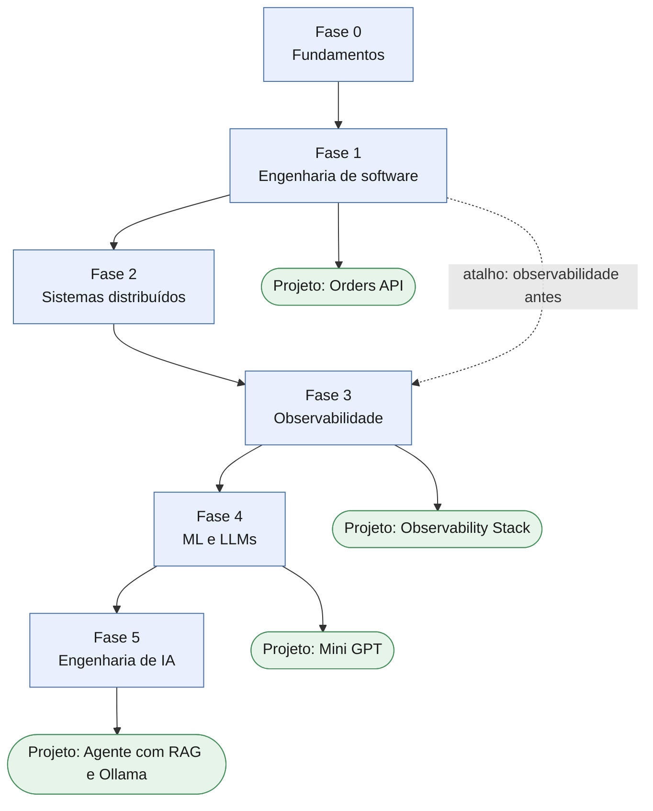

# Estudos: Engenharia de Software e de IA

Repositório onde organizo meus estudos de engenharia de software e de IA aplicada: o roadmap, as minhas anotações e os projetos de cada fase. A ideia é sair do "só escrevo prompt" para entender o que acontece por baixo, desde o terminal e o Git até observabilidade, LLMs locais, RAG e agentes.

## Visão geral

Detalhes por fase e a arquitetura do projeto final: [fluxograma completo](roadmap/fluxograma.md).

## Roadmap

O roadmap completo está em [`roadmap/`](roadmap/README.md). Atualizo o status abaixo e marco as caixinhas conforme avanço.

| Fase | Foco | Status |
| --- | --- | --- |
| [Fase 0: Fundamentos](roadmap/fase-0-fundamentos.md) | terminal, Git, redes, sistema operacional | Não iniciada |
| [Fase 1: Engenharia de software](roadmap/fase-1-engenharia-de-software.md) | Python, algoritmos, design, testes, APIs, SQL, Docker, CI | Não iniciada |
| [Fase 2: Sistemas distribuídos](roadmap/fase-2-sistemas-distribuidos.md) | escala, filas, resiliência, arquitetura | Não iniciada |
| [Fase 3: Observabilidade](roadmap/fase-3-observabilidade.md) | logs, métricas, traces, OpenTelemetry, Grafana | Não iniciada |
| [Fase 4: ML e LLMs](roadmap/fase-4-ml-e-llms.md) | matemática mínima, redes neurais, Transformers | Não iniciada |
| [Fase 5: Engenharia de IA](roadmap/fase-5-engenharia-de-ia.md) | RAG, agentes, MCP, evals, observabilidade de LLM | Não iniciada |

## Projetos

Um projeto por fase, cada um com README em inglês. Todos começam como "Planned" e o status muda quando eu realmente construo.

| Projeto | Fase | Status |
| --- | --- | --- |
| [Orders API (FastAPI)](projetos/01-api-fastapi/README.md) | 1 | Planned |
| [Observability Stack](projetos/02-observability-stack/README.md) | 3 | Planned |
| [Mini GPT](projetos/03-mini-gpt/README.md) | 4 | Planned |
| [Local Agent with RAG](projetos/04-agent-rag-ollama/README.md) | 5 | Planned |

## Notas

As notas ficam em [`notas/`](notas/README.md), uma por tema, com as minhas palavras e o que me travou de verdade.

## Ferramentas

Claude Code no desenvolvimento do dia a dia, Ollama para modelos locais e Obsidian para anotações.

---

## English summary

This repository tracks my study path in software engineering and applied AI: a phase-by-phase roadmap (Linux and Git, backend engineering, distributed systems, observability, ML fundamentals, and AI engineering with local models), my notes, and one project per phase. Project READMEs are written in English and start as templates marked "Planned"; status changes only when the work is actually done.
