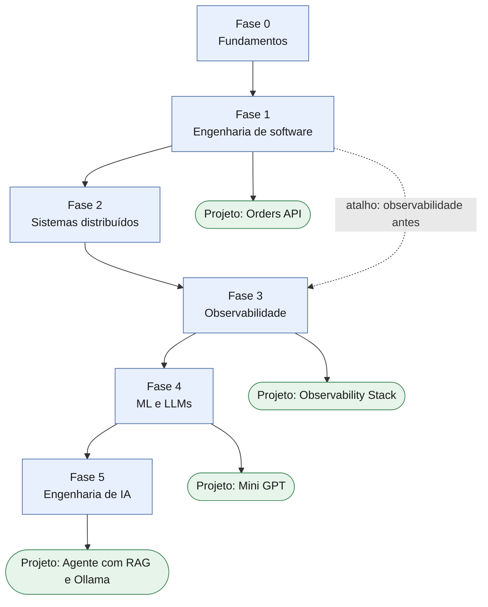
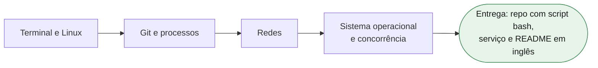
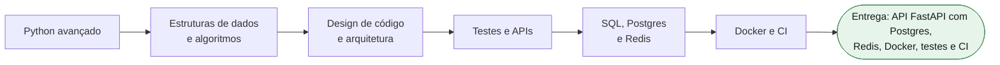
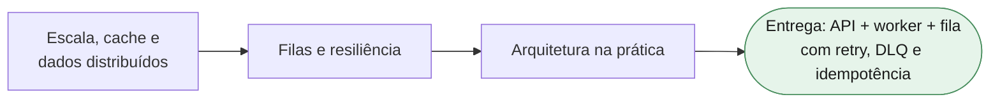
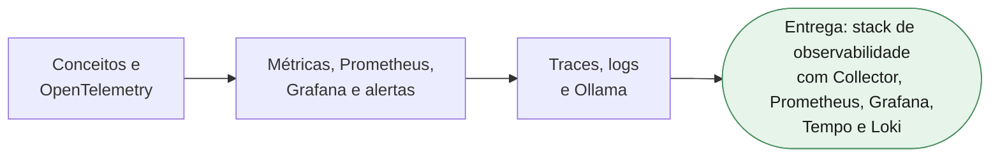
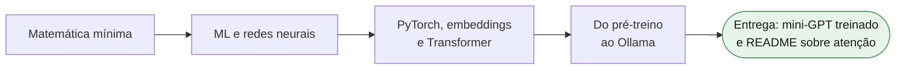
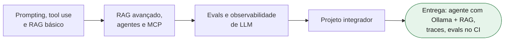
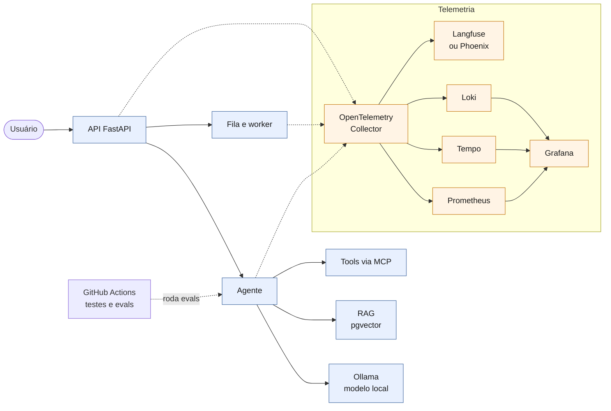

# Fluxograma do roadmap

[← Voltar ao roadmap](README.md)

Os diagramas abaixo são desenhados automaticamente pelo GitHub (e pelo Obsidian) a partir do código Mermaid. Se algum não aparecer, cole o código em [mermaid.live](https://mermaid.live) para visualizar.

## Visão geral

## Por fase

### Fase 0: Fundamentos

### Fase 1: Engenharia de software

### Fase 2: Sistemas distribuídos

### Fase 3: Observabilidade

### Fase 4: ML e LLMs

### Fase 5: Engenharia de IA

## Arquitetura do projeto final

Como as peças das Fases 1 a 5 se encaixam no agente com RAG e Ollama.

